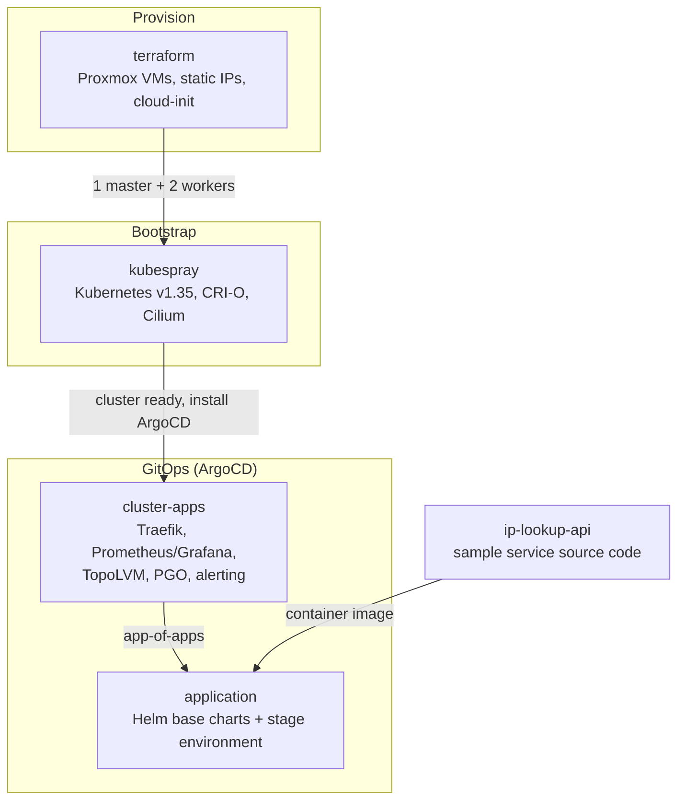

# DevOps Platform

A complete, GitOps-driven Kubernetes platform running on a Proxmox homelab. It takes a bare hypervisor all the way to a monitored, production-style cluster running a sample API:

**Proxmox VMs (Terraform) → Kubernetes (Kubespray) → platform services (ArgoCD) → application workloads**

## Architecture



## Repositories

| Submodule | Layer | What it does |
|-----------|-------|--------------|
| [`terraform`](./terraform) | Infrastructure | Provisions 1 control-plane and 2 worker VMs on Proxmox from a cloud-init template |
| [`kubespray`](./kubespray) | Cluster | Inventory and config to bootstrap Kubernetes (v1.35.4) with CRI-O and Cilium |
| [`cluster-apps`](./cluster-apps) | Platform | ArgoCD app-of-apps for cluster services: Traefik, kube-prometheus-stack, TopoLVM, PGO, alert rules |
| [`application`](./application) | Workloads | Reusable Helm base charts (`webapp-base`, `cronjob-base`) and stage-environment app definitions |
| [`ip-lookup-api`](./ip-lookup-api) | Application | The sample IP lookup API deployed on the platform |

## Tech Stack

| Area | Tools |
|------|-------|
| Infrastructure as Code | Terraform (Telmate/proxmox provider), cloud-init |
| Virtualization | Proxmox VE |
| Cluster provisioning | Kubespray (Ansible), Kubernetes, CRI-O, Cilium |
| GitOps | ArgoCD, app-of-apps pattern, Helm |
| Ingress | Traefik |
| Observability | Prometheus, Grafana, Alertmanager, PrometheusRules, ServiceMonitors |
| Storage | TopoLVM (LVM-backed CSI) |
| Databases | PGO (Crunchy PostgreSQL Operator) |

## How It Fits Together

1. **Provision**: Terraform clones an Ubuntu cloud-init template into three VMs with static IPs (`192.168.1.30-32`) and injected SSH keys.
2. **Bootstrap**: Kubespray turns those VMs into a working Kubernetes cluster.
3. **Platform**: ArgoCD is installed once with Helm. From there, `cluster-apps` uses the app-of-apps pattern to install and reconcile ingress, monitoring, storage and database operators.
4. **Workloads**: ArgoCD also watches `application`, which renders the Helm base charts with stage-specific values to deploy services like `ip-lookup-api`.

After the initial ArgoCD install, nothing is applied by hand. Everything flows from Git:

```
Git push → ArgoCD → Helm → Kubernetes
```

## Getting Started

Clone with all submodules:

```bash
git clone --recurse-submodules https://github.com/mahanrezaie/<root-repo>.git
# or, if already cloned:
git submodule update --init --recursive
```

Then follow the layers in order (each submodule's README has the details):

1. [`terraform`](./terraform): `terraform init && terraform apply`
2. [`kubespray`](./kubespray): run the playbook against the generated inventory
3. [`cluster-apps`](./cluster-apps): `helm install argocd ./argocd -n argocd --create-namespace -f ./argocd/values.yaml`
4. [`application`](./application): ArgoCD picks it up automatically through `stage-apps`

## Design Decisions

- **Separation of concerns**: infrastructure, cluster, platform services and application workloads each live in their own repo and can change independently.
- **Reusable charts**: `webapp-base` and `cronjob-base` mean a new service is just a values file, not a new chart.
- **Environment isolation**: environment config lives in `stage/`, and production can mirror the same structure.
- **GitOps**: Git is the single source of truth, so the cluster can be rebuilt from the repos.
- **Observability built in**: every service ships a ServiceMonitor, and cluster-wide alert rules are managed as code.

## Author

**Mahan Rezaie** · [GitHub](https://github.com/mahanrezaie) · [LinkedIn](#)
